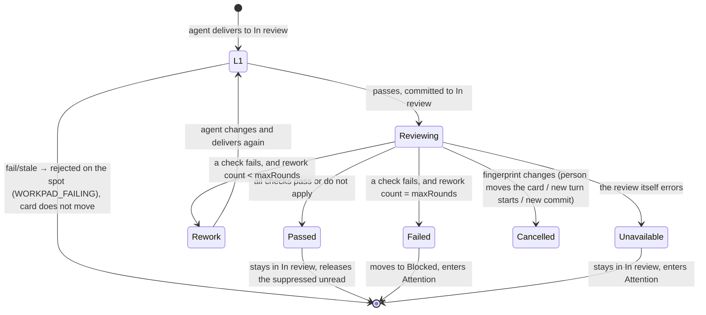

# Automatic delivery review (AUTO-REVIEW-SPEC)

> 2026-10-28: parts of this document were superseded by [GUARDRAILS-SPEC](GUARDRAILS-SPEC.md) (§12). Superseded: §1.1 user path, §4.1 L1, the rule kinds and `types` of §4.2, all of the configuration in §6, §7 Insights, rules / guidance / reviewDraft of §8.1, §8.4, most of the RPCs in §8.5, "Auto review comes before Workpad, and Workpad is collapsed by default" in §9.2 (the review is now the Review group inside Workpad, and Workpad is expanded by default), §9.3, What's new in §9.6, items 2, 4 and 5 of P3 in §12, and D7, D8, D10, D11, D13–D16. Still valid: §2, §3, §4.3, the session run of §4.4, §4.5, §5, the skeleton of §8.2, §8.3, §9.1, Rerun in §9.2, §9.4, D1–D6, D9, D12 and D17.

Status: P1, P2 and P3 are implemented and not committed (§12). Decisions are in §11. Card `4286f00a` (Auto Review).

## 1. Goal and user path

In one sentence: **with Auto review on, every agent delivery first goes through checks: Flowly runs the project's check commands, then an independent reviewer confirms the change did what the user asked for on the card and in the conversation; if it did not, the delivery is sent back to the agent for rework, and the user is notified only when it did.**

The user does not need to design rules. The default configuration works directly; when a card needs finer checking, they just tell the agent; and over time, rules are recommended by Insights from the things the user actually corrected.

### 1.1 User path

| Stage | What the user does | What the user sees |
| --- | --- | --- |
| New user | Nothing | No push. One passive sentence in the tour's More features (§9.6) |
| New user, after a while, deliveries often need rework | Clicks **Set up auto review** in Insights | At the top of Insights: "Of the N cards delivered in the last 14 days, M were changed again by you after delivery", with the cards attached (§7.1). Clicking enters the history analysis (§6.2) |
| Existing user upgrading to 1.8.0 | Clicks **Suggest checks from past cards** in What's new | The current project's gate summary and preselected checks (§6.2) |
| Anyone opening it on purpose | Edit project → turn on Auto review → tick the detected commands → Use these | Built-in check + detected commands (§6.1); with enough history, **Suggest checks from past cards** can be clicked |
| Day to day | Works with the agent as usual | After delivery the card face shows "Reviewing 1/3"; on a pass Attention reminds, and the drawer shows the review result first; on a failure the card returns to a work stage by itself and the agent receives a rework message |
| A complex card | Says in the session "this involves a migration, focus on whether old data can still be read" | The built-in check reads this sentence and judges by it (§4.2) |
| Rework hits the limit and still fails | Replies to the agent or takes over | The card is in Blocked, and Attention shows Review failed |
| After a while | Clicks **Add check** in Insights | Insights recommends a check grown out of what the user repeatedly corrected, or suggests pausing a check that has never failed (§7.2) |
| A few people fine-tune | Edit checks in the project settings, or **Adjust with AI** | The rule list; after talking to the agent in the setup card, Apply the draft (§6.3) |

### 1.2 Not in scope

Triggering when a person drags a card into In review; the review agent changing code; several reviewers voting; CI/PR status integration (PR automation is outside v1); external push; clearing Paseo's native turn-ended reminder (D4); temporary worktree isolation (D6); a card's own rule list, review levels, and rules triggered by changed paths (D11).

## 2. Reuse and known limits

| Need | Existing mechanism | Use |
| --- | --- | --- |
| Workpad check at delivery | `openItems()` + `WORKPAD_OPEN` / `acknowledgeOpen` (WORKPAD-SPEC §5.3, `server/delivery-gate.ts`) | L1 adds a hard rejection on top |
| Whether validation ran on the current code | `validationFreshness()` (`shared/workpad.ts`) | Use directly |
| The stage before delivery | The `status_changed` that enters In review carries `from` | Return target (§3.2) |
| Continuing after the return | A1 goes back to the most recent work stage (`resumeStage()`, `server/progress-rules.ts`) | Use directly |
| Temporary model session, structured output, timeout, hard delete | The summarizer: `agents.create({ outputSchema, labels })` + `runSummaryModels` + `summarizer-remove.ts` | Review session |
| Project-level temporary session | Flowly background workspace (BACKGROUND-WORKSPACE-SPEC) | History analysis (§6.2) |
| Sending a message to an existing session | The composer's send queue | Rework delivery |
| Reading the user's words in a session | `user_message` from `timeline.refetch({ projection: "projected" })`; the clues of project memory (PROJECT-MEMORY-SPEC §4.0) | Built-in check, history analysis, rework prompt |
| Periodic analysis | Insights run (INSIGHTS-REDESIGN-SPEC, WORKFLOW-INSIGHTS-SPEC §4) | Check suggestions (§7.2) |

Known limits:

1. **Paseo's native reminder cannot be stopped.** When the delivering turn ends, Paseo reminds "the agent has finished", and the review has not started yet; Flowly controls only its own Attention, and marks the review state on the card (D4).
2. **Paseo scripts cannot get the exit code.** Command checks are started by the daemon directly as child processes with an argument array.
3. **A shared workspace interferes across cards.** When several cards share the project root directory, a command measures the combined state of all the cards' changes. It does not isolate (D6), marks the result "shared workspace", and records the sha and dirty.
4. **Commands in the workpad are not run automatically.** They were written by the agent being reviewed, and running them as written would let it bypass Paseo's permission confirmations. The daemon runs only the commands in project rules, and rules can only be written or confirmed by the user (§6).

## 3. Flow and states

### 3.1 Trigger

An **agent** calls `flowly_update_status(in_review)`, passes L1 and the commit succeeds, the project has Auto review on, the card is not archived and is not a setup card (§6.3), and there are checks in effect for this card (§4.2). A person dragging into In review does not trigger it.

Exception (Ship to main, DELIVERY-MODE-SPEC §4.1): when the last review passed and already sent the ship message for the current commit, the workspace is clean, HEAD has not changed and no person has moved the card since, the agent's next delivery is not reviewed and gets no new ship message; only a `review_finished` event (with no result) is recorded. A new commit, a person moving the card, or Rerun starts a new review.

The review starts only **after the delivering session's current turn ends** (`agent.turn_ended`); if that session is already idle at delivery it starts immediately. After delivery, in the same turn the agent may still commit or change the workpad, which changes the fingerprint and invalidates the review. A waiting delivery is kept only in memory: if the plugin restarts during the wait, this delivery is not reviewed, the card stays in In review, and a person can press Rerun.



Only one review runs per project at a time (queued), because their cards may share a directory.

### 3.2 States

- **Reviewing**: the card is in In review. The **unread** signal of this card in Flowly Attention is not counted for now; permission requests, errors and questions still count.
- **Rework (R1)**:
  1. Return target = the `from` of the delivery event that triggered this review. When it is Design, Development or Test and that lane is on, go back there; otherwise (`from` is a non-work stage, the lane has been turned off, the event has been trimmed) take the most recent work stage by the Blocked branch of `resumeStage()`; if there is still none, use the first work stage that is on.
  2. In the same write, change the status (actor=system, `rule: "R1"`, task revision +1), **then** send the rework message (§5). The status leaves In review first, so when the new turn starts A1 does not change the card to Development.
  3. R1 runs as usual when the project has autoStatus off.
- **Failed (R2)**: the rework count has reached `maxRounds` and it still fails; no more messages are sent; the card moves to Blocked (actor=system, `rule: "R2"`, note "Auto review failed after N rework rounds") and enters Attention. When the Blocked lane is off it stays in In review. After that, when the user replies in that card's session, A1 pulls the card back to the most recent work stage as usual.
- **Unavailable**: the review mechanism itself errors: the working directory is unavailable, a command cannot start or times out, the review session fails or its output cannot be parsed, the rework session no longer exists, or Flowly restarts during the review. The card does not move (when delivery fails after R1, it stays in the returned state), enters Attention and shows the reason. It does not count toward the rework count.
- **Cancelled**: at the start the fingerprint is recorded (task revision, workpad revision, HEAD sha, dirty). If the fingerprint has changed before the result is written, the result is discarded: no status change, no message, no Attention. When the card is still in In review it shows "Review cancelled" and can be Rerun. Another card committing in a shared workspace also changes HEAD and cancels.
- A pass never moves to Done automatically.

### 3.3 Rework count

- `round` starts at 1 and goes +1 each time the work is delivered again after a Rework; rework count so far = `round - 1`. `maxRounds = 2` means at most 2 automatic reworks and at most 3 reviews; `maxRounds = 0` means the first failure goes to Blocked.
- Reset to 1: a person moved the card after the last review ended; the card started more than one turn (the rework message itself starts one turn, the extra is a person's message); the last review was Passed/Failed/Unavailable/Cancelled; a person pressed Rerun.

## 4. Checks

### 4.1 L1 Workpad (synchronous, D3)

Computed in `flowly_update_status(in_review)`, before the delivery commit. It takes effect only when the project has Auto review on.

| Workpad state | Result |
| --- | --- |
| No workpad | As the existing `SETUP_INCOMPLETE` (reject first, then allow) |
| A `fail` validation item | Reject, `acknowledgeOpen` has no effect |
| A `stale` pass | Reject, `acknowledgeOpen` has no effect |
| An unchecked acceptance criterion, or an `unrun` validation item | As the existing `WORKPAD_OPEN` (reject first, then allow) |

Error code `WORKPAD_FAILING` (no commit, no receipt, retryable): "Auto review is on for this project: {n} workpad checks failed or are out of date: … Fix them and rerun the checks on the current code before delivering. acknowledgeOpen does not apply." The workpad is the agent's own report, and L1 only blocks problems the agent itself admits; it is not the review's yardstick (D12).

### 4.2 Kinds of checks

| Kind | Judged by | Content |
| --- | --- | --- |
| **Built-in check "Does what you asked"** | Review session | Fixed; it compares the card title, description and what the user said in this card's conversation to judge whether the change did it (D12) |
| **Command check** | The daemon runs the command, exit code 0 passes | `argv`, optional timeout |
| **LLM check** | Review session | `prompt`: one concrete requirement that can be judged from the diff and the card |

In the UI they are all called "checks", with icons distinguishing commands from judgments.

- **Checks in effect**: the built-in check (when not paused) + the command checks and LLM checks that are not `off` and whose `types` is empty or contains the card's type. When the card has no type, all the checks that are not paused are in effect.
- When no check is in effect there is only L1, and delivery does not start a review.
- **The built-in check's yardstick** (given to the review session in this order):
  1. The card title and description;
  2. The messages the user sent in this card's sessions: the `user_message` entries among the last 200 entries of each session's projected timeline, with rework messages that start with `[Flowly auto review` removed, ordered by time, keeping the latest 30, no more than 12,000 characters in total and no more than 1,500 characters each; when it cannot be read, "(conversation unavailable)" is written and the review goes ahead anyway;
  3. The workpad (acceptance, validation, points of confusion) and the delivery note, marked "the agent's own report, context only".
- The built-in check's judging requirements: later instructions override earlier ones; what was said in the conversation to not do yet does not count as missing; when the request is too vague to judge, judge `na`; do not judge against the workpad. In a shared workspace (not a worktree, the review records `shared`) one more sentence is added: changes in the diff unrelated to this card may belong to another card, so do not judge fail on that basis, and judge fail only when what the user asked for was not done or was done wrongly.
- The built-in check cannot be deleted, only paused (`goal: false`). Its result id is fixed as `goal`, and other checks cannot use this id.

### 4.3 Running command checks

- At the start of the review the checks in effect are snapshotted into the review record; changing rules during the review does not affect this one.
- Command checks run one by one in list order, **all of them to the end**, and each result is written back as soon as it finishes.
- The daemon uses `spawn` in the card's workspace directory (argument array, not through a shell, its own process group, on timeout SIGTERM to the whole group, SIGKILL after 5 seconds). The environment adds `CI=1`, `NO_COLOR=1`, `FORCE_COLOR=0`. The default timeout is 600 seconds (10–3600).
- Exit code 0 is `passed`; non-zero is `failed`; a timeout or failing to start is `unavailable` (does not count as failing).
- The one that failed or is unavailable keeps the last 4 KiB of output (color codes removed), stored only in the review record and not written to logs (it may contain tokens). The result is not written into the agent's workpad.
- When a shell is really needed, the rule writes it as `["sh","-c","…"]`; that is rule content the user confirmed, not something Flowly concatenates.

### 4.4 Review session (built-in check and LLM checks)

- It runs only when all command checks are `passed` (or there are no command checks) (D9). When a command check is `failed`, the built-in check and all LLM checks are `skipped`, with the reason "Command rules failed."; when one is `unavailable`, the reason is "A command rule could not run."
- One temporary session judges everything in one go: created in the card's workspace, with the delivering session as its parent, with the same labels as the summarizer (`flowly=summarizer`, `flowly-task`, `flowly-review=1`), hard-deleted when done, and archived with a logged note when deletion fails. Timeout 15 minutes.
- Model: **Review model** in Settings → Models (`reviewModel` of the `task-summary` settings); when not set, the project's default model; when there is none, the summary model list.
- Input: card title, description, type; the built-in check's yardstick (§4.2); the workpad; the delivery note and outputs; a summary of the command check results; the project `guidance`; the diff (`git diff HEAD` plus the patches of the last 5 commits, truncated to 64 KiB with a note); and the checks to judge (id, name, prompt).
- Instructions: read-only, do not change files, do not run commands that change state; judge each one separately.
- Mode (2026-10-30): `config.modeId = readOnlyMode(provider)` (`shared/summary.ts`): `claude/*` and `claude-*` custom providers (such as `claude-compass-smith-sqp`) use `plan`, and other providers set nothing (never full-access). Otherwise a Claude review session under Always Ask stops at a permission confirmation on its first tool call, `runSummaryModels` counts that as a failure, and the whole review is `unavailable` ("The summary model asked for a permission.").
- Permission requests (2026-10-30): a provider without Plan Mode (Codex etc.) may still stop at a permission confirmation, and nobody in a temporary session can approve it. `finishRefusingPermissions` (`server/summary-models.ts`, shared by `runSummaryModels` and workflow insights), on receiving a `permission` state, replies deny to each pending request (with a note so the model continues answering without that tool), then waits for the turn, at most 20 times; only when a request cannot be denied or the count is exceeded does it count as failure. This way a review is not `unavailable` because of a permission request, and the card does not stay in Attention for it (§3.2 Unavailable still enters Attention by design, for when it truly cannot run).
- Output (`outputSchema`, parsed leniently: take the first JSON object, drop unknown ids and bad entries):

  ```
  { rules: [{ id, verdict: "pass" | "fail" | "na", detail: string ≤ 600, file?: string, line?: int }] }
  ```

  `na` is treated as a pass and shown as "Not applicable". A missing id for a check → that check is `unavailable`; session timeout, failure or unparseable output → all `unavailable`.

### 4.5 Overall verdict

Any `failed` → not passed (R1 or R2); otherwise any `unavailable` → Unavailable; otherwise Passed.

## 5. Rework delivery and get_task

- The rework message is sent to the **delivering session**; when it has been archived or deleted it is not delivered, and it is handled as Unavailable (the card keeps the state after the R1 return). When the session is running it is queued and sent after this turn ends.
- Message format (starting with a fixed marker, to distinguish it from an ordinary follow-up):

  ```
  [Flowly auto review · rework 1/2]
  Commands: 1/2 passed
  ✗ Unit tests (npm test) exited 1:
      expected 410, got 404 (links.test.ts:88)
  LLM review: skipped (command rules failed)
  Fix these, rerun the affected checks, update the workpad and deliver to In review again.
  ```

  When the commands all pass and a judgment check fails, they are listed one by one as `✗ <name>: <detail> (<file>:<line>)`.
- `flowly_get_task.review`: state, round, maxRounds, reason, startedAt, finishedAt, and for each check its id, kind, name, state, command, exitCode, timedOut, tail (≤ 2000 characters), detail, file, line, reason. `task` does not repeat this record.
- `flowly_get_task.reviewRules` (when the project has it on): the checks in effect for this card (including whether the built-in check is on), `maxRounds`, and `guidance` only when there are judgment checks among them. The setup card and the card the current draft came from get all the checks (including paused ones and `types`) and `guidance`, plus the full text of the draft; other cards, when there is a draft, get only the source card and time. The setup card and the draft's source card get it even when the project is off.
- The skill and the description of `flowly_update_status` state `WORKPAD_FAILING` and the rework message: handle these comments first; the review compares against what the user asked for in the conversation.

## 6. Configuration

### 6.1 Turning the switch on and command detection (D13)

- When Auto review is turned on in Edit project and the project has no command checks yet, `reviews.detect-commands` is called to detect check commands from the project root directory, without calling an LLM and without running commands:

  | Basis | Detection | Ticked by default |
  | --- | --- | --- |
  | `scripts` in `package.json`, package manager by lockfile (`pnpm-lock.yaml` → pnpm, `yarn.lock` → yarn, `bun.lockb`/`bun.lock` → bun, otherwise npm) | Scripts named `typecheck`/`type-check`/`tsc`, `lint`, `test`: `[pm, "run", name]` | Yes |
  | Same | `build`, scripts whose name contains `e2e` | No |
  | `Cargo.toml` | `cargo test` | Yes |
  | `go.mod` | `go vet ./...`, `go test ./...` | Yes |
  | `pyproject.toml` / `pytest.ini` / `setup.cfg` mentions pytest | `python -m pytest` | Yes |
  | `Makefile` has a `test`, `lint` or `check` target | `make <target>` | Yes |

  At most 6, and scripts whose name carries `watch` are skipped.
- Below the switch the UI lists: the built-in check (fixed on the first row) and the detected commands (checkboxes), with the button **Use these**. The ticked commands are written into the rules and saved with Save (project revision +1). The user ticking is consent for the daemon to run these commands.
- When none is detected only the built-in check is shown.
- When the project has ≥ 5 agent deliveries in the last 90 days, the same place also has the button **Suggest checks from past cards** (§6.2).

### 6.2 History analysis and gate summary (D15, D16)

**Entry**: the button of What's new 1.8.0 (current project); Suggest checks from past cards in the project settings; Set up auto review in the Insights rework hint (§7.1). All three open that project's Edit project and start the analysis; when opened from What's new and Insights, the Auto review section is placed first in the form (the host's dialog offers no scroll positioning).

**Condition**: ≥ 5 agent deliveries in the last 90 days. When not met, no model is called, and it shows "Not enough past deliveries in this project yet." and the detection result of §6.1. Only one analysis runs per project at a time; when one is already running, progress is shown.

**Statistics (daemon, deterministic)**:

- Delivery: the `status_changed` where an agent moves a card to In review.
- **Rework after delivery**: while the card is in In review, a user message started a turn (A1, `from: in_review`), and that turn was not reverted by A1r when it ended (that turn really did work). A turn that does no work, such as "commit and push", is reverted by A1r and does not count.
- The numbers of the gate summary (cards delivered, cards reworked after delivery) are computed by the daemon, not trusted from the model.

**Analysis session**: a temporary session is created in the project's Flowly background workspace (same as Insights: restored or reused before use, the workspace archived after use; the session hard-deleted when it ends), with the model set for Insights, timeout 15 minutes.

- Material (total length ≤ 100,000 characters):
  1. Cards delivered in the last 90 days: short ID, title, type, labels, the recap of the latest card summary (≤ 400 characters), whether reworked after delivery;
  2. The user's own words in the rework turn: the clues project memory collected in that turn (`feedback`, `message`, ≤ 3 per card, each ≤ 400 characters); when project memory is off, "(memory off)" is written;
  3. The check commands that have appeared in workpads and the number of cards they appeared in;
  4. The commands detected in §6.1; the Commands section of `AGENTS.md`/`CLAUDE.md` (≤ 4000 characters);
  5. The current rules (name, command or prompt).
- Instructions: classify the reasons for rework after delivery; propose checks only for reasons that could have prevented rework on **at least 2 cards**; what can be judged by exit code is written as a command check (prefer scripts the repository already has), and the rest as one judgeable LLM check; do not repeat the built-in check and existing rules; at most 6.
- Output:

  ```
  { reasons: [{ title, cards: string[], quote?: string }],              // reasons for rework, ≤ 6
    checks:  [{ rule: Rule, cards: string[], why: string ≤ 300 }] }    // Rule as in §8.1, ≤ 6
  ```

- Validation: `cards` must be cards in the material, and the cards of `reasons` must be cards reworked after delivery; entries with fewer than 2 cards are dropped; `rule` is validated per §8.1, and an id that collides with an existing rule gets a number appended; invalid ones are dropped, not truncated. When everything is dropped the summary is shown with no new checks.
- The result is written as the project draft (§6.4), `by: { analysis: true }`: `rules` = current rules + new checks; `added` lists the ids of the new checks, each with `cards` and `why`; `summary` = `{ delivered, reworked, reasons, dropped? }`. Before the draft is written, the limit of 10 per kind is judged check by check on "current rules + new checks", and new checks that do not fit are dropped, `dropped` records how many were dropped, and the UI shows "N suggested checks did not fit: a project holds at most 10 of each kind."; the analysis itself does not fail because of this.
- The user's own words in the rework turn (material 2, the quote in §7.1, the material of §7.2): the `feedback` and `message` kinds among the project memory clues, with time from this turn's A1 up to the card's next `agent.turn_started` (to now if there is no next turn). Clues are written only after the turn ends, so `turn_ended` cannot be the boundary.

**UI** (inside the Auto review section):

```
34 cards delivered in the past 90 days, 9 of which you changed again after delivery
  Tests not run or not passing      4 cards  #a1b2 #c3d4 …
  New text not in every language    3 cards  #e5f6 … "New text needs every language too." (translated)

Checks
 ✦ Does what you asked
 ☑ Typecheck           npm run typecheck
 ☑ Unit tests          npm test             4 cards
 ☑ New text in every language catalog       3 cards
[Use these and turn on]                [Adjust with AI]
```

A card reference is clickable and opens the card. New checks are ticked by default, and unticked ones are not added on Apply. When the switch is off, the commands detected in §6.1 are also merged into this list (built-in check, detected commands and analysis checks in order, with commands likewise untickable), and there is just one button **Use these and turn on**; the ticked commands are written together with Apply (`add` of `apply-draft`). When there is no analysis result yet (too few deliveries, analysis failed, analysis running), the detection block is still shown on its own per §6.1. While analyzing it shows "Analyzing past cards… uses tokens", and on failure it shows the reason and can be retried.

### 6.3 Adjust with AI (setup card, D7)

- The **Adjust with AI** button of the project settings (also shown when the switch is off). When the project already has an unarchived setup card it opens that, otherwise it creates one: title "Auto review setup", type `chore`, created in Design (using the first lane that is on when the lane is off), `task.reviewSetup: true`. The daemon also creates a session: the model is the project's default model, then the default model of Settings → Models, and `claude/claude-haiku-5-5` when there is none; the first message is the setup instructions. Clicking opens this card's drawer. When the session could not start, the card is still created and the hint says to start it from the card.
- Delivering the setup card does not start a review (it does not change code, and what is to be accepted is the draft); L1 applies as usual.
- **Setup instructions** (English, read by the agent) ask the agent to: first read the repository (scripts, CI, `AGENTS.md`/`CLAUDE.md`/`CONTRIBUTING.md`, README) and `get_task.reviewRules`; use the question tool to ask the user what they want held at delivery; write what can be judged by exit code as command checks, preferring repository scripts, and write LLM checks only for what needs judgment, with each covering only one thing; try each command once in the workspace, write the result and duration in the note, and leave out of the draft any that do not run; suggest `types`; the built-in check already covers "did what the user asked", so do not repeat it; submit the complete list with `flowly_propose_review_rules`, and submit again when the user wants changes; do not change repository files, and when a check script is missing, ask the user first and, with agreement, do it as an ordinary change of this card.
- **Tool** `flowly_propose_review_rules` (MCP and CLI `review-rules`, callable by any card's session): parameters `request`, `expectedRevision`, `rules` (the complete list, §8.1), `guidance?`, `maxRounds?`, `goal?` (built-in check switch), `note` (≤ 1000). A validation failure returns `REVIEW_RULES_INVALID`, listing all the problems, and writes nothing. On success it writes the project draft (§6.4), `by: { taskId, agentId }`, and returns the difference from the current rules (ids added, changed, deleted).

### 6.4 Draft and Apply (D8)

- One draft per project, a new one overwrites the old one. Writing does not change the project revision, and does not make other agents' context stale.
- When there is a draft, the top of the project settings Auto review section shows it; a draft that came from a setup card is also shown in that card's drawer. Content: additions, changes (before and after) and deletions one by one, the agent's note or the history analysis summary; buttons **Apply** (when the switch is off, "Apply and turn on") and **Discard**.
- The draft is identified by `at` (different on every write, at least 1 ms later than the previous one). Apply and Discard both carry the `at` of the draft shown in the UI; when it does not match the current draft or the draft no longer exists, `status: "stale"` is returned and nothing is written, and the UI refreshes the draft and says "The agent proposed a new draft. Review it before applying."
- Apply can carry `exclude`: ids of new checks not to add (only ones in the draft's `added`). It replaces the project's `rules`, `guidance`, `maxRounds`, `goal` with the draft's (the fields the draft has), turns on Auto review, project revision +1, clears the draft, and closes the project settings.
- When the draft's `baseHash` (hash of rules, guidance, maxRounds, goal at the time of proposing) differs from the current one, the rules have been changed since the draft: Apply first returns `status: "confirm"`, the UI says "Applying will overwrite these changes", and it writes only after confirmation.
- Discard only clears the draft. Neither applying nor discarding notifies the agent.

### 6.5 Manual editing

The check list in the project settings (§9.3) can add, edit, delete and pause directly, saved with Save, not through a draft.

## 7. Insights

### 7.1 Rework hint (D14)

- When all the conditions are met, the top of the Insights page shows a rework hint: the project does not have Auto review on; at least 3 cards were reworked after delivery in the last 14 days (the definition of §6.2); Not now was not clicked in the last 30 days. The numbers and cards are computed by the daemon when Insights is read, independent of Insights' model run or switch.
- Content:

  ```
  Of the 12 cards delivered in the last 14 days, 5 were changed again by you after delivery
    #a1b2 Add link expiry "New text is not in every language" (translated)  #c3d4 …
  Auto review can catch this kind of problem before delivery and send it back automatically when it fails.
    [Set up auto review]   [Not now]
  ```

  Each card carries the user's own words that project memory collected in the rework turn (when there are any, ≤ 60 characters), up to 3 cards.
- Set up auto review → §6.2. Not now → the time is recorded, and it is not shown again for 30 days.
- One-time tip `review-suggest`: when the project has a rework hint and Insights is not open, it points to Insights (§9.6).

### 7.2 Check suggestions

In Insights' periodic run (the same model call as Skills, with the switch, period, model and replacement rules all inherited from INSIGHTS-REDESIGN-SPEC), when the project has Auto review on, one more kind of suggestion `review_rule` is added:

- The material gains a section "Auto review": the current rules (name, command or first line of prompt); the number of reviews and failures of each check within the window; the cards reworked after delivery and the user's own words in that turn; failures that repeatedly appear in rework messages.
- Instructions: propose checks only for reasons that existing rules did not cover and that made the user rework or made the review fail on at least 2 cards; prefer things that were already said (AGENTS.md, memory, skill) and still go wrong repeatedly; at most 3.
- Each suggestion carries one rule (validated per §8.1) and the cards it is based on; ones that duplicate existing rules (similar name or prompt) or suggestions dismissed within 30 days are dropped.
- The UI is in the "Auto review" section of Insights:

  ```
  On 4 cards, after delivery, you asked to complete the multilingual entries
    #a1b2 #c3d4 #e5f6 #0a9b · "New text needs every language too." (translated)
    Check: every newly added UI text appears in all the language catalogs
    [Add check]  [Dismiss]
  ```

  A command suggestion shows the full command. **Add check** adds this rule to the project (a number is appended on id collision, project revision +1), and marks the suggestion accepted. When the same kind of check is already at 10 it does not write, and returns "This project already has 10 LLM checks. Remove one first." (likewise for commands), and the suggestion stays open.
- **Pause suggestion** (deterministic, not through the model): an LLM check that is not paused (excluding the built-in check) and was judged ≥ 20 times in the last 30 days and never failed → "<name> passed all 20 reviews. Pause it to save tokens?" [Pause] [Dismiss]. It is computed after each successful Insights run of the project; when the same check already has an open, accepted or within-30-days dismissed pause suggestion, it is not raised again.

## 8. Data

### 8.1 Project

```
project.autoReview?: {
  enabled: boolean,                        // default false
  maxRounds: int 0–5,                      // default 2
  goal?: boolean,                          // built-in check, on when absent
  rules: Rule[],                           // command checks ≤ 10, LLM checks ≤ 10
  guidance?: string,                       // ≤ 4000, project background shown only to the review session
}
Rule = {
  id: string,                              // 1–40 characters [a-z0-9-], unique within the project, cannot be "goal"
  name: string,                            // ≤ 80
  types?: TaskType[],                      // applies only to cards of these types; unset means all (D10)
  off?: true,                              // paused
} & ( { kind: "command", argv: string[], timeoutSec?: 10–3600 }   // argv ≤ 30 items, each ≤ 500
    | { kind: "llm", prompt: string } )                            // ≤ 2000

project.reviewDraft?: {
  rules: Rule[], guidance?, maxRounds?, goal?,
  note: string,                            // ≤ 1000; the agent's note
  by: { taskId, agentId } | { analysis: true },
  added?: [{ id, cards: string[], why }],  // checks newly added by the history analysis
  summary?: { delivered, reworked, reasons: [{ title, cards, quote? }], dropped? },
  at, baseRevision, baseHash,
}
```

- Writing a draft does not change the project revision; changes to `autoReview` (Save, Apply, Add check) change the project revision.
- **Migration**: a project that has only the P1 `checks` reads them as command checks (`id` generated from the name, a number appended on duplicates), rewritten as `rules` on the next save; invalid old data is kept, not reset.

### 8.2 Card

- `task.reviewSetup?: true`: setup card.
- `task.review`: the most recent review, a new one overwrites the old one; writing does not change the task revision.

```
Review {
  trigger: { eventId, agentId, from },     // eventId is empty when a person presses Rerun
  round: int ≥ 1, maxRounds: int 0–5,
  state: "running" | "passed" | "rework" | "failed" | "unavailable" | "cancelled",
  reason?: string,                         // ≤ 500
  fingerprint: { taskRevision, workpadRevision, sha?, dirty },
  shared: boolean,                         // not a worktree
  rules: [{ id, kind: "command" | "llm", name,
            state: "queued" | "running" | "passed" | "failed" | "na" | "skipped" | "unavailable",
            ms?, argv?, exitCode?, timedOut?, tail?,   // tail ≤ 4 KiB, only when failed/unavailable
            detail?, file?, line?,                     // reason for the verdict, kept when passed too
            reason? }],                                // reason for skipped/unavailable
  model?: string,
  startedAt, finishedAt?
}
```

- At the start all checks are `queued`; commands go one by one to `running` and then to a result; the judgment checks are `running` together while the review session runs, and their results are written back together. The built-in check's entry is `id: "goal"`, `kind: "llm"`, `name: "Does what you asked"`.
- A review still `running` at plugin start is changed to `unavailable` ("Flowly restarted during the review.").

### 8.3 Events

`review_started`; `review_finished` (the note carries the result summary, plus `results: [{ id, state }]` for Insights statistics); `status_changed` + `rule: "R1"` / `"R2"`; `review_rules_proposed` (the agent submits a draft). The activity timeline shows an "Auto review" label.

### 8.4 Insights

`workflow-insights.json`: `findings[].target` gains `review_rule`, carrying a `rule` field; a pause suggestion is likewise stored as a finding (`target: "review_pause"`, `ruleId`, `title` is the rule name, `reviews` is the number of verdicts); a new `reviewNudges: { [projectId]: { dismissedAt } }`. `review_rule` and `review_pause` form a class of their own, and a new Insights run replaces only the suggestions in this class that are still open, without affecting skill drafts and other suggestions.

### 8.5 RPC

| Name | Input | Output |
| --- | --- | --- |
| `reviews.rerun` | `{ taskId }` | `{ ok }`; the card must be in In review, the project on and with checks in effect, and no review running |
| `reviews.detect-commands` | `{ projectId }` | `{ commands: [{ name, argv, checked }] }` |
| `reviews.analyze-history` | `{ projectId }` | `{ status: "started" \| "running" \| "insufficient" }` |
| `reviews.analysis-status` | `{ projectId }` | `{ state: "idle" \| "running" \| "failed", error?, startedAt?, eligible }` (in memory only, idle after a daemon restart; `eligible`: ≥ 5 agent deliveries in the last 90 days, which decides whether Suggest checks from past cards is shown) |
| `reviews.apply-draft` | `{ projectId, at, confirm?, exclude?, add? }` (`add`: the ticked detected commands `[{ name, argv }]`, added as command checks; ones with an identical command already present or over the limit are skipped) | `{ status: "applied", revision } \| { status: "confirm" } \| { status: "stale" }` |
| `reviews.discard-draft` | `{ projectId, at }` | `{ status: "discarded" \| "stale" }` |
| `reviews.setup-card` | `{ projectId }` | `{ taskId, created, sessionError? }` |
| `insights.add-review-check` | `{ findingId }` | `{ revision }`; the suggestion must be open |
| `insights.pause-review-check` | `{ findingId }` | `{ revision }` |
| `insights.dismiss-review-nudge` | `{ projectId }` | `{ ok }` |

## 9. UI and reminders

### 9.1 Card face

When the card has a review record and is still within this round:

- `Reviewing n/N` (In review, in progress): a status strip expands at the bottom of the card (icon + text + the same dot-matrix sweep as a running card, following Reduce Motion and the sweep switch), expanding at the start and collapsing at the end; n is the number of checks finished.
- `Review passed` (In review), `Reworking 1/2` (the work stage after the return), `Review failed` (Blocked, or In review when the Blocked lane is off), `Review unavailable` (In review, or the work stage when delivery failed after R1), `Review cancelled` (In review).
- The card's accessibility label carries the review state.

### 9.2 Drawer (D17)

- (Deleted 2026-10-28: the former "when the project has Auto review on, the Auto review section comes before Workpad and Workpad is collapsed by default". The review is now the **Review** group inside Workpad, and Workpad is expanded by the user's drawer default, see GUARDRAILS-SPEC §7.1.)
- Auto review section: split into the **Commands** and **LLM review** groups (the built-in check is the first row of the LLM review group), with "passed/total" at the right of each group title; each row has a status icon, name and duration. A `failed` row expands to show the tail of the command output or the verdict reason and file location; a `passed` judgment check can be opened to see the reason; `skipped` and `unavailable` rows show the reason; in a shared workspace it is noted. It updates check by check during the review (reusing the card detail's etag reads, with no new polling).
- When the card is in In review, the project is on with checks in effect, and no review is running, there is **Rerun** (round resets to 1, and rework goes to the session of the most recent delivery).
- The setup card's drawer shows the project draft (§6.4).

### 9.3 Project settings (Edit project → Auto review)

```
Auto review                                   [On]
  Every delivery runs an LLM review and uses tokens.
  <draft block, when there is a draft>
  Checks
   ✦ Does what you asked                       [Pause]
   ▶ Typecheck        npm run typecheck
   ▶ Unit tests       npm test
   ◆ New text in every language catalog · feature, bugfix
  [Add check]  [Suggest checks from past cards]  [Adjust with AI]
  Review guidance                                (when there are judgment checks)
  Max rework rounds  2
```

- When the switch is off only the switch, the draft block (when there is one) and Adjust with AI are shown; on first turning it on it enters the detection flow of §6.1.
- The cost line is shown only when the built-in check or an LLM check is on (cost information).
- Each row: the name; a sub-line shows, when there is content, the original command or the first line of the prompt and the type filter; paused ones are dimmed. Clicking a row edits: name, kind, command (one line, split on spaces, spaces inside quotes kept, not a shell) or prompt (multi-line), types (multi-select), pause, delete. The built-in check can only be paused.
- Suggest checks from past cards is shown only when the switch is on and the project has ≥ 5 agent deliveries in the last 90 days (when the switch is off, it is entered from What's new or Insights). After an analysis failure the same button is shown as Retry.

### 9.4 Attention

- New reasons: review failed, review unavailable (only while the card is still at the position that review left it in). The signal key is `review:<state>:<startedAt>`, for Snooze to judge "there is a new signal" (ATTENTION-DISMISS-SPEC, signal key table; it belongs to the Needs you side). Review failed is ranked first, like questions and permissions.
- A pass is not a reason of its own: the unread suppressed during the review is released after the pass, and Mark as read clears it as usual.

### 9.5 Insights page

The rework hint (§7.1) is at the top of the page; check suggestions and pause suggestions (§7.2) are in the "Auto review" section, positioned after Skills and before other suggestions; when there are no suggestions the whole block is not shown.

### 9.6 Onboarding, What's new, telemetry, i18n

- **New users** (D14): one passive line in the tour's More features, with no button: "Auto review: deliveries are checked before they reach you, and go back to the agent when they fall short." One-time tips: `auto-review` (when cards in the project show a review state and no card is open; ranked after next-move and before first-workpad); `review-suggest` (§7.1, ranked before `first-skill-draft`). `tipIds`, `tipText`, `nextTip`, the onboarding-logic tests and the ONBOARDING-SPEC tip table change together.
- **Existing users** (D15): one What's new 1.8.0 item: "Auto review: deliveries are checked before they reach you, and go back to the agent when they fall short. Flowly can suggest the checks from your past cards." With the button **Suggest checks from past cards** (new button action: open the current project's Edit project and start §6.2).
- **Telemetry**: `f_auto_review` (an unarchived project has Auto review on); `f_auto_review_llm` (among them, one with the built-in check on or an LLM check not paused). TELEMETRY-SPEC §4.2 and the key-set test change the definition together; no new field is added.
- **i18n**: new copy goes into all the catalogs; rule names, prompts, guidance, draft notes and analysis summaries are content written by users or models and are not translated; the built-in check's name is translated at render time and stored in English.

## 10. Against the product constraints

| Constraint / existing decision | Handling |
| --- | --- |
| "Automatic assignment, multi-agent handoffs, role orchestration… are outside v1" | The user approved an exception on 2026-10-27 (D1, D2), already written into AGENTS.md Product invariants |
| "ordinary follow-up sends exactly the user's text" | The rework message is a delivery of the automatic review with a fixed marker, not an ordinary follow-up (D2) |
| project memory `8424d1ab`: rejected the server automatically sending a session a make-up registration message | That one was about a process step the agent had missed; the rework message is the result of quality acceptance, and the user confirmed it is allowed (D2) |
| "A turn ending never automatically completes the card." | Triggered only by the delivery event; a pass does not enter Done; R1/R2 only move to a work stage or Blocked |
| The exceptions for hard-deleting temporary sessions and the Flowly background workspace | The review session is already in the Auto review exception; **the history analysis session (§6.2) needs to be added to the lists of the AGENTS.md background workspace and hard-delete exceptions** (changed together when P3 is implemented) |
| "Use subprocess argument arrays, never shell interpolation" | Command checks accept only argv |
| "Do not expose tokens … in logs" | Command output exists only in the review record (truncated), not in logs |
| UI copy rule | Keep only cost, state and non-obvious consequences; rule names and so on are filled by user content |
| Onboarding upkeep | One tour line, two tips, one What's new item (§9.6) |

## 11. Decisions

| # | Question | Decision |
| --- | --- | --- |
| D1 | Whether to allow Flowly to create review sessions automatically | Allowed (2026-10-27) |
| D2 | Whether to automatically send the original session a rework message on failure | Send automatically; the limit is changed in project settings; when the limit is reached and it still fails, move to Blocked and enter Attention (2026-10-27) |
| D3 | Whether L1's fail/stale is rejected on the spot or sent back after delivery | Rejected on the spot (2026-10-27) |
| D4 | Whether to clear Paseo's native reminder during the review | Not handled; the review state is marked on the card (2026-10-27) |
| D5 | Which stage to return to | The work stage the card was in before delivery (2026-10-27) |
| D6 | Whether a shared workspace runs commands in a temporary worktree | No isolation (2026-10-27) |
| D7 | Where the conversation with an LLM to configure rules lives | A dedicated setup card, as a secondary entry, Adjust with AI (2026-10-28). Rejected: a standalone chat panel in the project settings |
| D8 | How rules proposed by an agent or the analysis take effect | Draft + the user's Apply (2026-10-28). Rejected: written directly after the agent confirms (every later delivery would then run these commands automatically) |
| D9 | Whether to still run the review session when a command check fails | Skip (2026-10-28) |
| D10 | Whether a rule can be limited by card type | An optional type filter, unset means all (2026-10-28) |
| D11 | How to express card-level requirements | No card rules; the review reads what the user said in the card's conversation (2026-10-28). Rejected: card-added rules + draft + Apply (too many concepts, users would not know how to use it); review levels Thorough and path-triggered (not for now) |
| D12 | The review's yardstick | The built-in check "Does what you asked": card title, description and the user's own words; the workpad is the agent's self-report, for reference only (2026-10-28). Rejected: the default rule "Workpad acceptance met" (the examinee sets their own exam) |
| D13 | How to give commands when the switch is turned on | Detected deterministically from the repository, confirmed by the user ticking, no LLM (2026-10-28) |
| D14 | How new users encounter it | No active push; one passive sentence in the tour; an Insights hint when there is much rework after delivery (2026-10-28) |
| D15 | How existing users encounter it | A What's new 1.8.0 button, using past cards to produce the gate summary and preselected checks (2026-10-28) |
| D16 | How AI recommends rules | One history analysis: the upgrade button, the settings button and the rework hint enter the same analysis; Insights' periodic run recommends incremental checks (2026-10-28) |
| D17 | What the user reads once it is on | The drawer centers on the review result, Workpad collapsed by default (2026-10-28) |

## 12. Phases

1. **P1 (implemented)**: L1, command checks, review record, card-face state and Attention, R1/R2, rework delivery, project settings.
2. **P2 (implemented)**: rule list (commands + LLM, type filter, pause), setup card and draft (`at` check, `baseHash` confirmation), review session, Review model, per-check results, `get_task.reviewRules`.
3. **P3 (not implemented)**:
   1. The built-in check and the user's-own-words input (§4.2, §4.4), with "Workpad acceptance met" removed from the setup instructions;
   2. Command detection and Use these (§6.1), the settings UI adjusted per §9.3, Set up with AI renamed Adjust with AI;
   3. The drawer centers on the review result (§9.2);
   4. History analysis and gate summary (§6.2), draft extension (§8.1), the What's new button (§9.6);
   5. Insights rework hint, check suggestions and pause suggestions (§7), `review_finished.results`;
   6. Onboarding and tips (§9.6), the AGENTS.md exception lists (§10).

## 13. Acceptance

### 13.1 P1, P2 (regression)

- With the project on, when an agent delivers and the workpad has a fail or stale → `WORKPAD_FAILING`, rejected even with `acknowledgeOpen=true`, and the card does not move; with the project off it is the same as before.
- Agent delivers → the review starts after that session's current turn ends, and during it the card does not enter Attention for unread; after a pass it shows Review passed, and unread enters Attention as usual.
- Delivering from Test, one command with a non-zero exit code → back to Test, Reworking 1/N, the original session receives a rework message with the marker, `get_task.review` has the comments; A1 did not change the card to Development.
- After `maxRounds` reworks, failing again → Blocked, Review failed, Attention, and no more messages are sent; with `maxRounds = 0` the first failure goes to Blocked; with the Blocked lane off it stays in In review.
- While a review is in progress, a person drags the card, sends a message, or there is a new commit → the result is discarded; while still in In review it shows Review cancelled and can be Rerun.
- Command does not exist, times out, review session fails, original session archived → Review unavailable, and the rework count does not increase.
- Of three commands the second fails: all three run to the end (passed, failed, passed), all judgment checks are skipped, and it is returned per R1.
- The review session output lacks one → that one is unavailable; the rest all pass → Review unavailable.
- The review session is hard-deleted when it ends. A person dragging into In review does not trigger it; delivering the setup card does not trigger it.
- Draft: invalid → `REVIEW_RULES_INVALID`; Apply replaces the rules, project revision +1, turns on Auto review; while looking at draft A, B arrives → Apply/Discard return stale; rules changed after the draft → confirm first.
- A check with `types: ["bugfix"]` does not run on a feature card; an `off` one does not run.
- P1's `checks` are read as command checks and written as `rules` after saving.

### 13.2 P3

- Project has Auto review on, no other checks: after delivery only the built-in check runs; the review session's input has the card title, description and the user's messages in the conversation (without rework messages), and the workpad is marked as the agent's self-report.
- The user first asks for A in the conversation, then says "do A later": when the change did not do A the built-in check does not judge fail because of A.
- Built-in check paused (`goal: false`) and no other checks: delivery does not start a review.
- Turning on the switch: a TS project (with `pnpm-lock.yaml` and typecheck, lint, test, build and test:watch scripts) detects `pnpm run typecheck`, `pnpm run lint`, `pnpm run test` (ticked) and `pnpm run build` (unticked), without test:watch; after Use these they are written with Save; detection runs no command.
- Fewer than 5 deliveries in the last 90 days: Suggest checks from past cards is not shown; entering from What's new shows "Not enough past deliveries…" and the detection result, and does not call the model.
- History analysis: the rework-after-delivery statistics exclude turns reverted by A1r; the result is written as a draft with `by: { analysis: true }`, and the numbers in `summary` equal the daemon's statistics; checks based on fewer than 2 cards are dropped; after unticking one and Apply, it is not in the rules; the analysis session is hard-deleted, and the background workspace is archived after use.
- Insights: project with Auto review off, 3 cards reworked after delivery in the last 14 days → the rework hint is shown at the top; after Not now it is not shown for 30 days; Set up auto review enters the history analysis. With the project on, the periodic run produces `review_rule` suggestions, after Add check the rule is added, project revision +1, and the suggestion is accepted; suggestions that duplicate an existing rule are dropped.
- An LLM check passing all 20 times in the last 30 days → a pause suggestion appears; the built-in check gets no pause suggestion.
- Drawer: with the project on, the Auto review section is before Workpad and Workpad is collapsed; with the project off, Workpad is expanded.
- The What's new 1.8.0 button opens the current project's Edit project and starts the analysis; new users do not see What's new, and the tour has only the passive line; the `review-suggest` tip appears only once, and only when there is a rework hint.
- `f_auto_review_llm` is true when only the built-in check is on.
