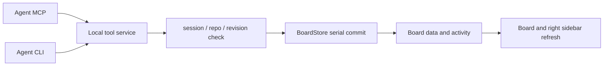

# Phase 2: Agent tools and skill implementation contract

2026-11-06 Paseo 0.14 addition: the `flowly` MCP server is no longer written into the agent creation config, and is instead injected by `agent.session_open` on every start; an idle session added through "Send Kanban work instructions" also has MCP after it is reopened. The statements below such as "write the MCP config at creation" and "an existing session has only the CLI" follow [PASEO-SESSION-TOOLS-SPEC](PASEO-SESSION-TOOLS-SPEC.md).

2026-10-22 turn checklist addition: the skill and the live get_task share a short action checklist, and an old session gets the latest rules by reading the card; the output fields are an optional compatible addition, and no write gate is added. The statistics script is calibrated in step, see [TURN-CHECKLIST-SPEC](TURN-CHECKLIST-SPEC.md).

2026-10-22 delivery constraints addition: delivery/result supports atomic registration of outputs, and acknowledgeOpen becomes confirmation after the first rejection; MCP, CLI and skill are synced, see [DELIVERY-CONSTRAINTS-SPEC](DELIVERY-CONSTRAINTS-SPEC.md).

2026-10-15 revision (the user asked to provide tools and the skill only to sessions managed by the board): "sessions managed by the board" means two kinds: created from Start session in the card sidebar (identity pre-allocated and credentials written before creation, MCP), or one where the user explicitly clicks "Send Kanban work instructions" in the session preview (CLI). `agent.session_open` only continues writing the environment variables for a session that already has a credential file, and no longer creates new credentials for other sessions in the card workspace (such as ordinary conversations, side chats, and sessions newly opened from native entries). Credential files written before the revision are kept, and can be revoked per session only after the user confirms.

The later single-root decision is in [SINGLE-ROOT-SPEC.md](SINGLE-ROOT-SPEC.md): a new card's tool context uses only the native Paseo project root; existing multi-repo cards keep their original read-only scope. The earlier multi-repo clauses below are used only to explain historical behavior.

Status: the user has authorized implementation and full testing. Updated: 2026-10-13.  
This document is the phase 2 implementation contract. The baseline is the revised [Phase 1 spec](PHASE-01-SPEC.md).

## 1. Goals and decisions made

When working in the workspace linked to a card, an agent can read the current task, the effective repo scope, update the card status and report progress. The user sees the result on the board, continues to direct a chosen session, and finally confirms the task is done.

| Item | Phase 2 decision |
| --- | --- |
| Tool scope | Three tools: read the current card, update status, report progress |
| New session | When created from the card sidebar it automatically carries MCP + skill + the current task context |
| Existing session | The sidebar "Send Kanban work instructions" provides CLI + skill to the selected session; the existing conversation is kept |
| Agent status permissions | Set `in_progress`, `blocked`, `in_review`; `done`/`cancelled` are decided by the user, and Backlog/Todo are also managed by the user |
| Multiple sessions | Each can report on and operate the same card separately; status conflicts are detected, with no automatic main Agent, handoff or scheduling |
| repo scope | Re-checked on every read/write: when unspecified it is all of the project's current repos, and once specified it is the selected repos |
| Relationship of CLI/MCP | Both entries call the same service, the same validation and the same persistence writer |

The user has authorized implementing this way and completing the tests, including "Agent delivers to In review, the user confirms Done" and "explicit onboarding of an existing session". This phase adds no automatic claiming, task decomposition, stage dependencies, automatic handoff, PR flow or automatic project completion.

## 2. Inherited relationships and boundaries

- One board project corresponds to one Paseo project, and stores one or more repos/dirs.
- One card corresponds to one workspace; its sessions are the zero or more sessions under this workspace.
- A card `repoPaths=[]` means all of the project's current repos; when one or more repos are selected explicitly, only those directories are the Agent's work scope.
- The workspace's start directory / source repo and the task scope are separate. Editing the scope does not rebuild the workspace and does not migrate sessions.
- An already linked workspace can keep its ownership by another native Paseo project. Compatibility is judged through Phase 1's canonical path / Git common directory; **the native project IDs are not required to be the same**.
- The repo corresponding to a worktree uses that checkout, and the other effective repos use the project's registered directories. A worktree is not described as an isolated environment for multiple repos as a whole.
- The scope is a task instruction boundary, and the actual read/write permission is decided by the provider; the tools provide no file-write sandbox.
- A session's running/idle/permission/error and the card's business status are independent. Turn ended, a permission request and session archiving do not advance the card automatically.

## 3. Complete usage path

### 3.1 New session

1. The user opens the card sidebar, picks the provider/model/mode, and fills in the initial instruction.
2. The plugin prepares the session: it reads the current card/project, validates the workspace, pre-allocates the `agentId`, and generates a tool credential and CLI context file bound only to that agent/card/workspace.
3. It creates the session through the workspace SDK, passing this `agentId`, the MCP config, the skill instructions and Phase 1's task/directory context. Other MCP, provider options and permission choices are merged as normal.
4. Before starting work, the Agent reads `flowly_get_task`; its identity and current card are determined by the onboarding config, with no need to fill in a task ID by hand.
5. When it actually starts work, it sets In progress; it reports along the way; when the current delivery is done it sets In review, listing the results, validation and unfinished items.
6. The user continues to instruct from the sidebar, asks for rework or confirms Done.

Pre-allocating the ID gives the pre-creation MCP injection an explicit session binding; the card is not inferred from cwd/title/label. When creation fails, the draft and preparation information are kept; a retry first checks whether that agent ID has already been created, to avoid a duplicate session. If it was partially created, show the existing session and the error, with no automatic deletion.

### 3.2 A session that already exists / was created from a Paseo native entry

1. The user selects the target session and clicks "Send Kanban work instructions".
2. The backend checks the session's actual workspace, the current card and the repo scope, and prepares that session's CLI context file.
3. Only to the target session it sends the current task context, the skill content, and the CLI absolute path / context file path; it uses the existing Steer/Interrupt semantics and does not clear the ordinary follow-up draft.
4. The Agent calls the CLI with its existing shell tool. It reads the same live task context and uses the same status interface.

It does not depend on hot-inserting MCP into a running session. `agent.session_open` can inject plugin-specific environment variables into an explicitly linked, interactive session to help CLI discovery; it does not guarantee that the provider loads the skill automatically, and does not automatically send a prompt to all sessions. A session created from a native entry can likewise enable the CLI/skill explicitly through the sidebar.

"Instructions sent" only proves that Paseo accepted the message; only an actual tool/CLI call result may show "Kanban tools used".

## 4. Status and multi-session behavior

| Work situation | Card action | What to report |
| --- | --- | --- |
| Actually starting work | In progress | The scope this turn is responsible for and the starting items |
| Partial progress / one repo done | Keep the status, report progress | The part done, the other repos/tasks still to do |
| This session has a problem, but the overall task can still move | Report a blocker, and do not automatically block the whole card | The affected scope, the input needed |
| The overall task cannot continue | Blocked | The blocking reason, the release condition, what the user needs to provide |
| Overall block lifted / entering rework | In progress | The reason for resuming or the rework requirement |
| The overall delivery is ready for the user to check | In review | The delivered content, validation evidence, unrun items, remaining issues |
| User accepts/cancels | The user sets Done/Cancelled | The Agent has no right to take this step through the phase 2 tools |

The update tool allows three target statuses; when the source status is Done/Cancelled or archived, Agent writes are rejected. Backlog/Todo to In progress is an explicit report after the user has chosen and instructed that session, and does not mean automatic claiming.

When several sessions read the same version, only the first status change succeeds, and the second must re-read. There is no automatic priority, "last write wins", automatic main Agent or completion vote. The skill requires each session to distinguish its own contribution from the whole-card result; a part being done does not mean the whole card enters In review. The service validates only the structure and the current status, and cannot independently prove from one line of report that all the business work is done.

## 5. Live task context and validation

### 5.1 What `flowly_get_task` returns

- The IDs of the current agent/card/workspace; the card title, description, status, priority.
- The project ID/title, the corresponding native Paseo project ID, and the workspace's actual native owner; the two can differ.
- The scope mode `all`/`selected`, the current effective repo list, each repo's actual working directory, and the workspace start directory.
- Two version numbers: `revision.task` and `revision.project`.
- The latest 20 activities, the statuses the Agent can set, the reason it cannot write, the tool/skill version.
- The workspace execution state and the summaries of sessions in the same workspace (ID/title/execution state, at most 20). Filter the SDK's paged results by the stable workspace ID; when they cannot be obtained completely, mark them explicitly as partial/unavailable, and do not treat missing results as "no other sessions". These execution states are for observation only, and are not proof that the whole card is done.
- The `request` prepared for the next write: a unique ID and a server-generated `issuedAt`. It only reads the task, and creates no activity in advance and changes no status.

It reuses `BoardService.context`, `repoMatcher` and the effective-directory mapping, so that the tools do not form a separate directory judgment. Every write re-reads the latest project; a card that defaults to all repos is validated against the new list immediately after directories are added/removed.

### 5.2 Validation order for every write

1. Validate the onboarding credential and resolve the agent/card/workspace it is fixedly bound to; filling in another target card separately is not accepted.
2. Refresh the agent and workspace through the Paseo SDK, confirm the agent is active and its `workspaceId` matches the binding, and the workspace is available and still belongs to the project repos.
3. If the same request has already completed, handle the receipt per section 7; a replay is not a new write. A card that is finished/cancelled or archived can explain the current unwritable state and is not resubmitted because of it; when the session identity or native resource is invalid, read permission is not opened up.
4. In `BoardStore`'s serial mutation, re-read the card/project, check the active state, the unfinished state, the two version numbers task/project, and then commit.
5. Return an explicit commit receipt and the latest context. Native resources and local files cannot form one cross-system transaction; a native archive that happens after validation will be found by later reads/calls, and no global lock is falsely claimed.

Editing the scope increases the task revision; a project directory change increases the project revision. Checking only the task revision would miss a scope change of "default all repos", so both take part in the write condition.

The working directories obtained through MCP/CLI are used for the Agent's current work plan. The skill requires re-reading before starting a work stage, before reporting after long work, and after a conflict. File operations are not executed through these tools, and the tools cannot retroactively block a file change the Agent has already completed under an old instruction.

## 6. Contract of the three tools

The MCP server name: `flowly` ([naming revision](FLOWLY-NAMING-SPEC.md)). Input/output use the shared Zod contract, and a successful result provides both JSON text and `structuredContent`. The table below does not include a hand-filled agent/card ID, and the identity is determined by the connection config.

| Tool | Input | Effect |
| --- | --- | --- |
| `flowly_get_task` | Empty object | Returns the section 5.1 context, the versions and the next write request ID |
| `flowly_update_status` | `expectedRevision: {task, project}`, `request: {id, issuedAt}`, `status`, `note` | Validates and changes the status, records the agent activity; returns the commit receipt and the current context |
| `flowly_report_progress` | The same version/request, `note`, optional `kind: progress/blocker/result` (default progress) | Records an activity and does not change the business status; returns the commit receipt and the current context |

Constraints: versions are positive integers, the note after trim is 1–10000 characters, and status is `in_progress/blocked/in_review`. Unknown fields are rejected. Pasting a credential or another card's ID into the input does not produce a cross-card update.

When the status really changes the task revision increases; **merely reporting progress does not increase the task revision**, changes no card field or updatedAt, and increases only the board revision and the activity. So progress records of several sessions can be appended in order, and notes do not create status/form conflicts with each other. Progress still validates the task/project versions at read time, to avoid continuing to report under the old context after the user changed the scope / finished the card. Setting to the status it already has is handled as one progress activity; the latest report time comes from the activity record.

The activity fields keep actor/agentId/note/action/from/to/at, adding an optional `reportKind`; the actual agent ID is recorded. The retention rule of the latest 100 activities follows Phase 1. Tool annotations: the read tool is read-only; the write tools declare that they modify the local task record, and cannot be marked side-effect-free.

Error results use `isError: true` and a structured `code/message/retryable`, and give no success receipt:

| Error | Behavior |
| --- | --- |
| `REVISION_CONFLICT` | Gives the current two versions and asks for a re-read; no automatic overwrite, no automatic retry with the new version |
| `INVALID_STATUS` / `TASK_FINISHED` | Explains the Agent status permissions or that the user has finished/cancelled; the record is kept |
| `ARCHIVED` / `RESOURCE_UNAVAILABLE` / `WORKSPACE_INCOMPATIBLE` | Writes are forbidden, stating the specific linkage problem |
| `UNAUTHORIZED` / `SESSION_MISMATCH` | Does not leak other cards' context; writes are forbidden |
| `REQUEST_REUSED` / `REQUEST_EXPIRED` | Not committed; explains that the parameters differ on reuse or a re-read is needed to get a new request |
| `PASEO_UNAVAILABLE` / `TOOLS_UNAVAILABLE` / `STORE_INVALID` | Reports unavailable, keeps the file; does not claim the status update succeeded |

## 7. Conflicts, retries and persistence

### 7.1 A single commit path



`BoardStore` is the only writer, and the CLI/MCP do not modify `board.json` directly. One successful commit persists the card change, the activity and the request receipt together atomically, and then responds. Hooks still record only observation events and do not replace the tools in updating business status.

### 7.2 Lost responses and duplicate requests

- `request` is produced by the read interface, bound to the writing session/card; a new request is recommended to be valid for 15 minutes. After long work, re-read first.
- The receipt key is a digest of the agent ID + the verified request ID; it stores the normalized parameter digest, the original action, the event ID, the version/status at commit time and the time, and does not store the raw signature carrier or bearer credential. A repeated call with the same request/parameters returns the original commit receipt, marked `replayed=true`, with no repeated modification or new activity.
- The same key with a different note/status/action returns `REQUEST_REUSED`. A different request, even with the same note, is another legitimate report from the user/Agent, and no content-guessing de-duplication is done.
- Receipts are recommended to be kept for 7 days, with at most 5000 globally. Expired receipts are cleaned up first; unexpired receipts are not evicted to make room, and when capacity is insufficient new Agent writes are rejected with the reason stated, while manual board operations remain available.
- An old retry for which no receipt is found and whose issuedAt is beyond the new-request validity must be rejected; an old request cannot be treated as a new write again after its receipt has been cleaned up. The server validates the request's source/binding, and an expiry check cannot be bypassed by a caller faking the time.
- A repeated request returns the original commit facts and the **current** card context, each labeled separately; the original success status is not described as "still that status now".
- On timeout/disconnect the Agent retries the same request and parameters; after receiving an explicit conflict/expiry it re-reads and judges whether any action is still needed, and does not blindly generate a new request to submit again.

`request.id` is a server-signed opaque carrier, containing a unique nonce, issuedAt, the bound agent/card/workspace and the task/project versions. The signature covers these fields; an issuedAt/expectedRevision passed separately must be consistent with it. The caller copies the full request, without changing the time or assembling an ID itself. It is used only for commit correlation and does not replace the connection identity credential; the signature/credential must not be written into notes, activities or diagnostic logs.

### 7.3 Data version

Phase 1's current data version is **2**. Phase 2 is recommended to use version **3**, adding `agentReceipts`, and supporting an optional reportKind on activities. All project/card/link/repo scope fields are kept.

Reading v2 fills in empty receipts; v1 is first migrated per Phase 1 to unrestricted v2, and then enters v3. Reading does not change the disk; the first successful mutation atomically writes v3, with the previous file as a backup. An invalid/unknown version fails and is kept. An old implementation should not write back a v3 file, to avoid losing receipts.

The persistence schema and the UI board view are separate: `board.read` returns only the project/card/activity/versions the board needs, and does not send internal receipts in bulk to every client. Tool receipts are returned through the current session's write result, to avoid board polling amplifying 7 days of receipt data.

## 8. Local service, identity and how it runs

### 8.1 Service choice

Use a loopback HTTP service in the plugin server: Streamable HTTP `/mcp` + JSON `/api`. MCP uses the official TypeScript SDK; the Node adapter handles HTTP, and the business service reuses the same store. The transport uses session-less request handling, and the necessary business state is all persisted in the store.

It listens on `127.0.0.1`, checks Host/Origin, and validates the bound credential before handling a request; it is not opened to other hosts. The MCP factory creates the tool set from the verified identity each time, and the actor/task is not chosen from user input.

The MCP initialize/tools-list stage only validates the signed config, and does not require the pre-allocated agent to have completed native persistence; otherwise a circle forms: "the tools must connect to create the agent, but the tools require the agent to exist". The actual get/update/progress calls must do a live membership check. The timing of the initial prompt and the native agent save needs a smoke check, and when it is earlier than the available state a retryable error is returned explicitly, with no skipping of validation.

### 8.2 Identity config

The credential generated by the backend is bound to `agentId + taskId + workspaceId`, used by both the CLI and MCP. On each call the native agent is refreshed again to verify real membership. The agent ID of an MCP-created session can be specified through an SDK parameter before creation, so there is no need to have the model fill in an agent ID by hand.

The CLI context file is separate per agent ID, containing that agent's bound credential and the service discovery file path, mode 0600. The CLI by default discovers the binding through `FLOWLY_CONTEXT_FILE` or the explicit file path the sidebar provides; if there is a `PASEO_AGENT_ID`, it must match the agent in the file. An ordinary terminal that lacks a session identity gets no unrestricted human write mode.

These are all trusted local plugins/Agents under the same OS user, not a mutually isolated process identity system; the credential/membership check is for specifying the call target and avoiding mistaken writes, and cannot prove who read a file accessible to the same user.

### 8.3 Run files and reload

Under the plugin data directory, generate the tool service discovery, the private signing key, the per-session context, the independent Node CLI and the runtime skill. Files are written atomically; directories are 0700 and private data 0600. The CLI/skill paths are stable; the user's global MCP config or the shared repo's AGENTS.md / global skill directory is not written. 

The listener uses a persisted port and signing key, kept after a reload, to make sure existing MCP configs stay valid. A port conflict does not silently switch ports. On stop, the listener/handler are closed; data and discovery information are kept.

**A tool service failure does not take down the whole board.** A separate tools health is provided, showing the reason for unavailability; Phase 1's board / manual status / ordinary follow-up stay normal. A new session by default requires tool preparation to succeed; if unavailable, the user can explicitly choose "create an ordinary session", following Phase 1's behavior, and onboard later. Files are not deleted automatically and the key is not reset to fix a conflict.

### 8.4 Cold start of the Paseo SDK context

The 0.11.2 server entry has no separate public `paseo` property; the SDK comes from the RPC/hook context. The tool service receives the current process's public SDK from these contexts, does not depend on the private DaemonClient, and builds no second UI connection.

After a reload and before any RPC/hook has been received, it cannot falsely claim native membership has been confirmed. Merely preparing the listener does not mean tools are ready; calls involving identity/resource return a recoverable `PASEO_UNAVAILABLE`. The sidebar health/prepare RPC, interactive session_open and turn_started can establish the current SDK context; then native resources are refreshed. A turn already running at the moment of reload may have to wait for the next context / re-read; zero interruption is not promised, and no extra prompt is triggered to wake it.

The cache holds only the current process's SDK API; a certain callback's `context.signal` is not treated as the long-term service lifecycle signal. HTTP requests and plugin cleanup use their own cancellation mechanisms.

The first context acquisition and the provider MCP connection order are the focus of the pre-implementation smoke check. If the pinned host cannot support reliably establishing the context, it is not bypassed by guessing cwd or skipping membership; first revise this implementation path.

## 9. CLI design

The CLI is a lightweight caller of the same service, not a second database writer. The run path is returned by the plugin, for example:

```text
node <plugin-data>/flowly.mjs --context-file <session-context> current
node <plugin-data>/flowly.mjs --context-file <session-context> status in_progress --task-revision 7 --project-revision 3 --request-file <saved-request> --note "Starting changes to repo-one and repo-two"
node <plugin-data>/flowly.mjs --context-file <session-context> note --task-revision 8 --project-revision 3 --request-file <saved-request> --note "repo-one is done, repo-two is still being changed"
```

`current` (alias get) outputs the live context and the next request. `--save-request <path>` can save a non-credential request/version snapshot, to avoid copying fields by hand; `status`/`note` can read both versions together from `--request-file`, and explicit versions must match the snapshot. The saved file is also per-session, and a shared cwd is not used to infer identity.

Unknown/duplicate flags, missing parameters, and an illegal status/version/request are rejected. Success prints JSON to stdout, failure prints a structured error to stderr with a non-zero exit; the bearer token is not printed. Each call re-reads service discovery, and HTTP requests have a finite timeout. On timeout the request is kept, allowing a retry with the same parameters; the process exiting cannot be used to claim the commit failed or succeeded.

## 10. Skill content and loading

The plugin carries `skills/flowly/SKILL.md`, and the runtime copy is generated from the same content source. The name/description point only to "in a linked card, read the task, report progress and update status". This round does not generate the actual skill file; the following are its content requirements.

1. First read the current card and the effective repo/checkout directories, then start work; do not treat cwd as the repo scope.
2. Update only the card linked to the current connection, following the section 4 status semantics.
3. A single contribution of a multi-session setup uses a progress record, and cannot be used to claim overall completion.
4. A report states the result, validation, unrun items and real blockers; do not change status based on turn ended.
5. Before writing, use the latest task/project versions and request; after a conflict re-read and explain the difference, and do not directly overwrite the user's changes.
6. When the network result is unclear, first reuse the request to get the original receipt, and do not blindly create a duplicate action.
7. After the user narrows the repo scope, the next stage works in the new directories; when beyond the actual provider permission, report the limit.
8. When MCP is available use the three tools; otherwise use the designated CLI/context. When the tools are unavailable, say so in the reply, and do not claim the card has moved.
9. An overall delivery enters In review; Done/Cancelled waits for the user's decision.

A new session embeds the necessary rules into systemPrompt, giving the runtime skill path for detailed reading; an existing session's explicit instruction contains the necessary rules and the path. One cannot claim the provider discovered it automatically merely by putting SKILL.md in some folder. After implementation, validate the format with the skill validator, and have Luna do a real behavior acceptance.

## 11. UI/RPC and module breakdown

### 11.1 UI additions

- The new session form states that it carries board tools; after creation it shows the onboarding method MCP/CLI, the latest successful call and the reason tools are unavailable.
- An already selected session shows "Send Kanban work instructions", sent only to it; not broadcast to all sessions.
- Activity shows the Agent title/ID, action, note and time; a request retry produces no duplicate entry.
- Ordinary scope/status/archive edits keep using the Phase 1 interface. The new UI must also use the host theme and compact native layout.
- "Config provided / instructions sent" and "tool successfully called" are shown separately; a single green enabled mark cannot replace execution evidence.
- The success time of a read-only tool call is kept in the in-memory state of this run, and the card/board is not changed for instrumentation; after a reload, if there is no new call, it is shown truthfully. A write success can be restored from the persisted activity/receipt.

### 11.2 New RPCs (design contract)

| RPC | Purpose |
| --- | --- |
| `tools.health` | Listener and SDK readiness, non-sensitive errors / onboarding version; returns no secret |
| `tools.prepare-session` | Input card ID + creation operation ID; output the pre-allocated agent ID, the scoped MCP config, the CLI/skill/context paths and the current task context |
| `tools.prepare-existing` | Input card ID + agent ID, verify real membership, output the corresponding CLI/skill instructions and paths |
| `tools.access-state` | Query the config source and the latest successful call of the given card/session; the config existing cannot replace ready |

`tasks.context` is kept, and shares the effective scope/resource resolution with the get tool. A repeated operation ID of preparing a session returns the same pre-allocated ID; if the user changes the creation parameters or creation partly fails, first check the existing session and then decide the new operation, keeping the error/draft reviewable.

### 11.3 Module responsibilities

| Location | Responsibility |
| --- | --- |
| `shared/` | Tool/RPC/error/receipt schemas and status rules, runtime-neutral |
| `server/agent-service.ts` | Binding check, dynamic scope, two-level versions, status/progress commit and receipts |
| `server/tool-server.ts` | HTTP/MCP lifecycle, identity check, health and SDK context readiness |
| `server/tool-context.ts` | Session credentials, discovery files and runtime file preparation |
| `server/cli-source.ts` | Generates the independent CLI; only calls HTTP, and does not operate board files |
| `server/store.ts` | v3 read migration, serial atomic commit, activity/receipt persistence |
| `client/drawer.tsx` | New-session config, explicit onboarding of an existing session, target routing and feedback |
| `skills/` | The skill Markdown the plugin distributes; not a root code module |
| root entries | Only compose registration and cleanup; keep the existing client/server boundary |

## 12. Implementation roadmap and acceptance

### 12.1 Order after the design is confirmed

| Step | Deliverable |
| --- | --- |
| S0 | Verify in an isolated environment the pre-allocated agent ID, the provider MCP initialize / first tool call and the SDK context timing; if the capabilities do not match, revise the design first |
| S1 | Agent service, live context / identity / version validation, status rules, v3 receipts/migration |
| S2 | Local MCP/CLI, private context, health, reload and fault isolation |
| S3 | New/existing session UI onboarding, session_open env, skill distribution and loading |
| S4 | Paseo Luna 6 end-to-end acceptance, fixes, report, then stop for the user to check |

Each step follows this complete spec; when the host/provider capability or a product rule changes, revise the spec first. Before coding, verify the SDK agentId creation parameter, the MCP provider connection and the context cold-start timing; the product implementation's dependencies must not be widened through private APIs.

### 12.2 Acceptance checklist

The test stage uses a Paseo `codex/gpt-6-luna` session, rediscovers the model, passes `settings.modeId: "full-access"` explicitly at creation, and uses an isolated fixture; the test session is responsible only for verification scripts/evidence, and does not change the implementation or anyone else's work, and does not restart the daemon. UI acceptance binds only the user's non-fullscreen Paseo window, first checking the real window ID/title/geometry, and never operates the fullscreen window in use; when it cannot be selected unambiguously the UI items are marked unverified, and non-UI checks continue.

1. A new session gets the three MCP tools and the skill from the real UI; actual read → In progress → progress → In review, the card/activity visible, and the user confirms Done.
2. An existing session explicitly receives the instruction, and completes the same flow with the CLI; the ordinary draft is kept, the selected session is routed correctly, and MCP is not hot-plugged.
3. The context of default all repos and explicit single/multiple repos and an external worktree is correct; after the project adds/removes a repo, a write with the old project revision is rejected.
4. A linked workspace with a different native owner still works; another workspace/session, or another workspace with the same cwd, cannot be mistaken for the current card.
5. Of two sessions writing status at the same time only one succeeds; two progress records of the same version can be appended and do not increase the task revision; after a human scope/status edit wins, an old write is rejected.
6. After a timeout a repeated request produces only one activity/status commit; reusing an ID with changed parameters, expired with no receipt, and full capacity all have an explicit rejection; reload keeps receipts.
7. Archived/finished/cancelled cards, a missing agent/workspace, an incompatible directory and a wrong credential are rejected; turn ended/permission does not automatically finish the task.
8. After the UI is closed the Agent tools still work; during a reload when the SDK context is not yet ready they are explicitly unavailable, and after the context is obtained the existing MCP/CLI recover. A port conflict affects only the tools and does not break the board.
9. v1/v2 → v3 keeps the repo scope, links and history, reading does not change the disk, the first mutation backs up the previous version; invalid data is kept.
10. The new UI's wide/narrow windows, light/dark themes, instruction send failure, partial creation and recovery; the core system proves the loop only with real tool calls and Agent replies.

Phase 1's compact check after the revision is still blocked by CUA. Phase 2 acceptance must try a real narrow screen; if the tool is still blocked, record the exact uncovered items, and do not count old images as passing. The old same-path duplicate workspace observation is still not attributed; the new test isolates its counts, and does not delete or attribute existing resources.

## 13. Basis and this round's conclusion

Checked the local `@getpaseo/plugin` / `@getpaseo/client` **0.11.2** types/source: the public workspace agents.create accepts a pre-allocated agentId and an MCP config; the agent.create hook lacks an explicit workspace ID, while session_open has agentId/workspaceId but can only change env, so the card is not identified automatically from cwd. Refer to the [Paseo plugin reference](https://paseo.sh/docs/plugins/reference#before-hooks) and the [Paseo Agents SDK](https://paseo.sh/docs/sdk/agents).

HTTP service selection refers to the official [MCP TypeScript HTTP serving](https://ts.sdk.modelcontextprotocol.io/v2/serving/http.md): session-less factory, Node adapter, Host/Origin guards and separation of the caller identity. The specific package versions are locked at implementation, and the current document cannot replace the real provider onboarding acceptance of the pinned host.

The implementation uses the official MCP v2 Node adapter, the Paseo 0.11.2 SDK and persisted v3 receipts. S0 actually verified the pre-allocated ID of `codex/gpt-6-luna`, `full-access` and the order of the first MCP initialization, tool list and tool call; the full product acceptance results are recorded in the [Phase 2 verification](verification/phase-02.md).
