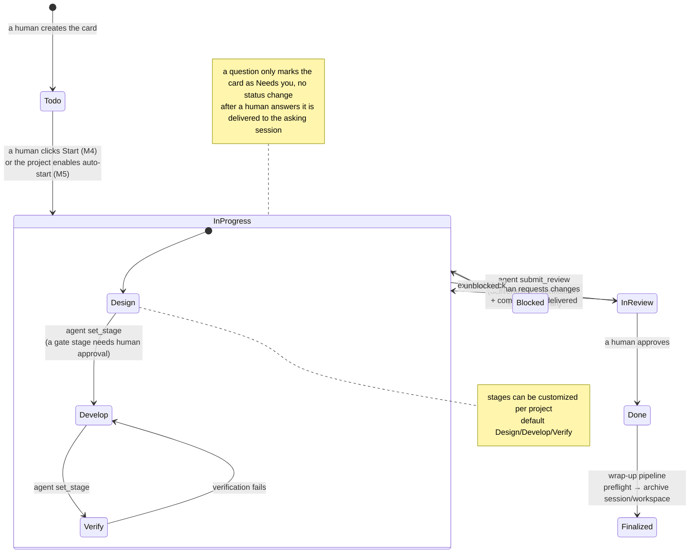

# Ultra Kanban v2 roadmap: a human-agent collaboration workflow inside Paseo

Status: planning draft, 2026-10-14. Adjusted per section 0: the current focus is manual multi-task management; M3 and later are long-term designs (D1–D6 confirmed, [PHASE-03-SPEC](PHASE-03-SPEC.md) deferred). Each milestone gets its own spec before implementation and needs authorization per AGENTS.md.
Baseline: Phase 1/2, [single-root](SINGLE-ROOT-SPEC.md) and [UI refresh](UI-REFRESH-SPEC.md) are delivered. The research conclusions on Multica carry over from [SPEC-OUTLINE §3](SPEC-OUTLINE.md), with the new capabilities from its README added (Inbox, Review gates, Autopilots, Squads, Retries, Usage).

## 0. Priority adjustment (2026-10-14, user decision, takes precedence over the text below)

- **Highest priority**: use the board to manage several parallel tasks by hand, conveniently. Status is mostly adjusted by hand, as simple as possible.
- **Agents adjusting status automatically is a long-term goal**, not the current focus. M3–M6 below (including [PHASE-03-SPEC](PHASE-03-SPEC.md)) are kept as long-term designs, with implementation deferred. The conclusions of D1–D6 are still valid and will be reused as they are then.
- The existing agent tools (`get_task`/`update_status`/`report_progress`) stay available and are not extended; it does not matter for use if the agent does not call them.
- The next step becomes **M2.5 manual multi-task management** (see section 8); the exact scope waits for the user's confirmation before a spec is written.

## 1. Target workflow

The user creates a card and clicks "Start", and the agent advances through stages following the project workflow (a built-in default, customizable). When a human must answer, it is only marked on the card and the status does not change; after delivery it goes to Review. After the human confirms completion, the system wraps up automatically (archives the session and workspace).

| Role | Responsible for |
| --- | --- |
| Human | Creating cards, starting, answering questions, reviewing deliveries, approving or sending back, handling exceptions |
| Agent | Reading the card and the project playbook, switching stages, reporting progress, raising a request on its own when a human is needed, submitting Review |
| Plugin daemon | Validating and persisting; observing sessions through hooks (approval requests, failures, silent endings) and hinting on the card; running the wrap-up pipeline; reconciling state after a restart |

"Needs you" is not a new business column and does not change the status (D2): the card keeps its current status, only shows a marker and the request count, and goes into the inbox. In review only means the agent has delivered and is waiting for your acceptance.

## 2. Current state and gaps

| Capability | Now | Gap |
| --- | --- | --- |
| Business status | 7 columns; the agent can set In progress/Blocked/In review; Done/Cancelled are set by a human | No concept of stages (design/development/verification) |
| Agent tools | `get_task` / `update_status` / `report_progress`, shared validation for MCP+CLI, CAS and idempotent receipts | Missing `set_stage`, `request_human`, structured `submit_review` |
| Needs a human | The card only shows session unread, approval and error counts | No "question + reply" loop; a human's answer cannot be routed back to the asking session |
| Review | After moving to In review there is only one note | No deliverables view and no approve/send-back buttons; work does not continue automatically after a send-back |
| Start | Manually create a session in the sidebar, with optional provider/model/mode | No one-click start, no project-level default agent/playbook, and no auto-start |
| Tool attachment | A session created in the sidebar automatically carries MCP; an existing session needs a manual "Send Kanban work instructions" | A session created from the native entry is not attached automatically (solvable with `before("agent.create")`) |
| Completion | A human sets Done, and all resources are kept | No wrap-up pipeline (preflight + archive) |
| Observation | turn started/ended and approval requests are written to the activity; the card shows a summary | No handling of failures, being stuck, silent endings or reconciliation after a restart; no execution history or cost |
| Cross-card view | Columns by project | No cross-project "waiting for you" inbox |

## 3. Benchmark against Multica

| Multica capability | Counterpart in Paseo | Now | Milestone |
| --- | --- | --- | --- |
| Assign issue → the agent picks it up and updates the status itself | Card "Start"/auto-start + board tools | Partial (a session must be created by hand) | M4 / M5 |
| The agent reports progress, raises blockers on its own, moves to review when done | `report_progress` / `update_status` / `request_human` / `submit_review` | Partial | M3 |
| Review gates: publish only after a human approves | In review deliverables view + approve/send back + Git info | Missing | M3 / M4 |
| Inbox: notify only when a decision is needed | Cross-project "waiting for you" inbox + composer pill/header button hint + native agent attention | Missing | M3 |
| Steer a running agent | Sidebar Steer/Interrupt already exist | Exists | — |
| Execution log | Paseo's native timeline + sidebar preview; card-level execution history | Partial | M5 |
| Skills (reusable playbooks) | Project playbook: per-stage instructions, definition of done, verification commands, injected when a session is created; Paseo/provider skills can also be reused | Missing | M4 |
| Retries & timeouts | daemon watchdog: failure retry, stuck alert, silent-ending reminder | Missing | M5 |
| Usage analytics | Agent usage summarized by card/project (depends on whether the SDK exposes usage) | Missing | M5 |
| Autopilots (cron periodic tasks) | The plugin server creates cards and starts them on a schedule | Missing | M6 |
| Squads / role routing | Design, development and review handed between different agents, with a review agent before the human | Missing | M6 |
| Projects + repo/docs as context | single-root project + playbook + project docs | Partial | M4 |
| Chat, multiple clients, self-hosting | Provided by Paseo itself | Provided by the host | — |

## 4. Milestones

### M3 Human-agent loop (suggested next step)

Goal: the agent switches stages by itself, raises a request when a human is needed, and submits Review; the human answers or reviews on the card, and the result goes back to the right session.

- Data: a task gets `stage` (`design/develop/verify` or null) and `requests[]`. A request has id, kind (`decision/approval/input/review`), question, options, agentId, createdAt, plus answer/answeredAt/answeredBy. A delivery record `deliverable` is also added: summary, verification, notRun, links, changes. Storage migration v3 → v4, keeping invalid data without resetting.
- Agent tools (MCP and CLI on the same service, reusing CAS and idempotent receipts):
  - `flowly_set_stage(stage, note)`: available only under In progress.
  - `flowly_request_human(question, options?)`: records a request, does not change the status, and marks the card "Needs you". At most 10 open requests per card.
  - Configurable workflow (D1): a project-level stage list, where each stage has a description, exit criteria and an optional human-review gate; a built-in default that can be set as the new-project default.
  - `flowly_submit_review(deliverable)`: structured delivery; the card moves to In review and is marked "waiting for your acceptance". The old `update_status(in_review)` stays compatible.
- Human-side UI:
  - Card: a "needs you" badge (warning color) and a question summary at the top right; the stage is shown as a small label in the signal row.
  - Sidebar: a fixed "Pending" block at the top: the question, option buttons and a reply box; or a deliverable card with "Approve / Request changes".
  - Reply or send-back: written to the card and delivered to the session that raised the request. The delivered content carries an explicit Kanban reply marker, which is an explicit Kanban action and is distinct from the rule that an ordinary follow-up is sent as it is. A reply does not change the status; on a send-back the card returns to In progress. When a human clicks "Approve" it is set to Done.
  - Inbox: the toolbar "Waiting for you (n)" lists, across projects, all cards with open requests or awaiting acceptance.
  - Inside the native session: the existing composer chip label now shows "Needs you"; the chip supports `popover`, so one can answer directly on the native session page.
- Hook signals (hint only, no business status change): approval requests and failed turns are hinted on the card; when the card is In progress and a turn ends with no tool report in that turn, it is recorded as a "silent ending".
- Skill: the stage protocol, when a human must be asked (irreversible operations, design trade-offs, missing information, out of scope), the deliverable format.
- Acceptance: one card goes through design → development → question → answer → verification → submit → send back → change → approve in full; covering multi-session conflicts, restarts and duplicate delivery (idempotency).

### M4 Start and wrap-up automation

- One-click start: the card "Start" button creates a session with the default provider/model/mode of the project playbook (full-access optional) and carries the card instruction, with the stage set to design.
- Automatic attachment: use `before("agent.create")` to inject MCP and environment variables into any session created in the card workspace. A session created from the native entry is also usable automatically; an existing session still goes through the explicit instruction.
- Project playbook (benchmarked on Skills): per-stage instructions, definition of done (DoD), verification commands, whether a human must review the design (design gate). Versioned, viewable in the sidebar.
- Wrap-up pipeline (runs after a human clicks "Approve", can be turned off per project):
  1. Preflight: all sessions idle; git working tree clean; branch pushed or merged; no unpushed commits. The result is written on the card.
  2. When everything passes and the project policy is "automatic", archive the card's sessions and workspace. Otherwise a confirmation dialog lists the items that failed and the human decides.
  3. Only the worktree workspace the plugin created for this card is archived automatically. Paseo deletes the worktree directory after archiving the last reference, so preflight must pass first. A directory-type workspace (such as the project root) is never archived automatically.
  4. A receipt is written to the activity; on failure the card shows "wrap-up failed" and can retry; the board card is kept and marked wrapped up.
- Git delivery info: the card and sidebar show the branch, ahead/behind, diff stat and PR/MR links (via `gh`/`glab` subprocesses with argument arrays). CI status is left for later.

### M5 Autonomous running and reliability

- Auto-start queue (benchmarked on assign + capacity): once enabled for a project, Todo cards start automatically by priority, with a maximum concurrency N, pausable and resumable.
- Watchdog: running beyond a threshold is recorded as stuck; a failed turn is retried automatically with backoff (up to n times) before a human is prompted; a silent ending sends one reminder (configurable).
- Restart reconciliation: hooks are best-effort delivery, so at daemon start and in periodic tasks the SDK is used to reconcile the actual state of sessions and workspaces and correct the card hints.
- Execution history: card-level record of each turn's session, start/end, result and duration, plus usage/cost if the SDK provides it; summarized by project.
- Notification: mainly Paseo's native agent attention plus the plugin inbox; optional external push (such as a SeaTalk webhook).

### M6 Teams and scale (candidate)

- Role handoff (Squads): design, development and review are done by different agents (possibly different providers), with a review agent doing one automatic review round before the human.
- Subcards and dependencies, with stage completion automatically waking the next stage; a planning agent splits the project goal into cards (the former A3/A4).
- Autopilot: periodic tasks (cron) create cards and start them automatically.
- External sync (Jira/GitLab issues), cross-host scheduling.

## 5. Project constraints that need adjusting

The following AGENTS.md clauses conflict with the goal and need the user's confirmation to change before the corresponding milestone starts:

| Current constraint | Suggested change | Milestone |
| --- | --- | --- |
| "Automatic assignment, multi-agent handoffs, role orchestration… are outside v1" | v2 introduces them by milestone: M4 one-click start, M5 auto-start queue, M6 role handoff; each off by default and enabled per project | M4–M6 |
| "Archiving plugin records … does not implicitly archive/delete Paseo resources" | After a human clicks "Approve", per the project wrap-up policy and when preflight passes, archive this card's sessions and the worktree workspace the plugin created; in other cases still no implicit archiving | M4 |
| "ordinary follow-up sends exactly the user's text" | Unchanged. Add an explicit "reply to request / request changes" delivery type that carries a Kanban marker | M3 |
| "A turn ending never automatically completes the card" | Unchanged. Turn events only produce hints; status changes come only from agent tool calls or human actions | — |

## 6. Decisions to confirm

| # | Question | Suggestion |
| --- | --- | --- |
| D1 | Fixed or configurable stages | **Decided**: configurable, built-in default Design/Develop/Verify, customizable by the user and settable as the new-project default (M3) |
| D2 | A new column or In review for "needs a human" | **Decided**: no status change, only a marker on the card |
| D3 | Whether a design proposal needs human approval by default | **Decided**: off by default, a gate can be turned on per stage |
| D4 | Scope and confirmation of the wrap-up archive | **Decided**: archive only the worktree the plugin created; automatic archiving when preflight is all green, otherwise a confirmation; a directory workspace is not archived automatically (M4) |
| D5 | Whether work continues automatically after a send-back or reply | **Decided**: yes, delivered to the original session; on a send-back the card returns to In progress |
| D6 | Whether the inbox includes session signals | **Decided**: yes, shown grouped separately from the agent's requests |

## 7. Next steps

1. ~~Confirm D1–D6~~ (done). The constraint changes in section 5 are written into AGENTS.md when the corresponding milestone is implemented.
2. ~~Write the M3 spec~~: [PHASE-03-SPEC](PHASE-03-SPEC.md), waiting for authorization to implement.
3. Implement: typecheck, focused tests, reload, then verify with a full-access `codex/gpt-6-luna` session and clean up the fixtures, then stop and hand over to the user for review.
4. After that proceed M4 → M5 → M6, each milestone with its own spec and its own authorization.

## 8. M2.5 Manual multi-task management (candidate scope, to be confirmed)

Uses only manual actions and the existing Paseo session signals, and adds no agent tool.

| # | Capability | Notes |
| --- | --- | --- |
| A | "Needs attention" overview | One toolbar entry that lists, across projects, the cards with pending session items: turn ended unread, waiting for approval, error; clicking goes straight to the card or session. Entirely based on existing signals |
| B | One-click start session | "Start session" on the card, reusing the last provider/model/mode, with the initial instruction defaulting to the card title and description, editable |
| C | Sort/filter cards by attention | Optionally put cards that need attention first within a column; filter "running / needs attention" |
| D | Manual wrap-up | An "Archive workspace" button on Done cards: first lists the check results (whether sessions are idle, uncommitted changes, whether the branch is pushed), and archives after confirmation; only for worktrees the plugin created, and for a directory workspace only the board record is archived |
| E | Card notes | Short notes can be appended on a card so a person can record progress (not delivered to the agent) |
